# From Power BI to a Snowflake Semantic View

**Hands-on lab · NZ SI Partner HOL · Demo 4**

## Overview

You already have business logic in Power BI: measures, relationships, a data model your customers trust. In this lab you bring that logic into Snowflake as a **semantic view**, so the same definitions power Power BI, Cortex Analyst and AI agents, with no re-keying.

Here is the path you will follow:

```
 Tasty Bytes data ──► star schema (dynamic tables) ──► Power BI template (.pbit)
                                                              │
                                              Semantic View Autopilot
                                                              ▼
                              Snowflake semantic view ──► SQL · Cortex Analyst · Power BI
```

### What You Will Do

| # | Step | You end up with |
|---|------|-----------------|
| 1 | Build the data foundation | Tasty Bytes star schema in `TB_PBI_DEMO.POWERBI` |
| 2 | Verify it | 7 checks, all `PASS` |
| 3 | Point the Power BI template at your account | A `.pbit` with your connection details |
| 4 | Import it with Semantic View Autopilot | A semantic view generated from the Power BI model |
| 5 | Review what converted | Which measures made it, which did not, and why |
| 6 | Query the semantic view | Governed metrics from plain SQL |
| 7 | Ask it questions in natural language | Cortex Analyst on top of your Power BI logic |
| 8 | Reconnect Power BI to Snowflake | Power BI reading the semantic view |
| 9 | Clean up | Everything removed |

### Prerequisites

- A Snowflake account where you can use `ACCOUNTADMIN`. A trial account is fine: <https://tinyurl.com/spn-hol>.
- Power BI Desktop (free) for steps 3 and 8. **Power BI Desktop runs on Windows only**, so use a Windows machine or VM for those two steps. Everything else works on any laptop.

> **Tip —** The Tasty Bytes model and Power BI template come from the Snowflake quickstart [End-to-End Analytics with Snowflake and Power BI](https://github.com/Snowflake-Labs/sfguide-end-to-end-analytics-with-snowflake-and-power-bi).

## Setup

### Where the Data Comes From

The Tasty Bytes sample data lives in a **public Snowflake bucket**, `s3://sfquickstarts/frostbyte_tastybytes/`. There is nothing to download or upload: `sql/01_setup.sql` creates a stage that points at the bucket and loads from there.

The lab loads **trucks 1-30 only**. That is about 4.7M orders from 2019-2022, which builds quickly. The full data set is about 900M rows.

### What Is in This Repo

```
sql/01_setup.sql              database, warehouse, stage, raw data (filtered load)
sql/02_star_schema.sql        date/time dimensions + dynamic tables (the model Power BI reads)
sql/03_roles_and_stage.sql    least-privilege analyst role + stage for the template upload
sql/04_verify.sql             checks that everything is right
sql/99_teardown.sql           removes everything
powerbi/TastyBytes_bound.pbit    the Power BI template (a DirectQuery model of the star schema)
docs/images/                  screenshots used in this guide
```

The lab creates a database `TB_PBI_DEMO`, a warehouse `TB_PBI_WH` and a role `TB_PBI_ANALYST`. Nothing else in your account is touched.

---

## Step 1 - Build the Data Foundation

Open a Snowsight SQL worksheet (or Cortex Code) and run these three files **in order**, each one fully before the next:

1. `sql/01_setup.sql`
2. `sql/02_star_schema.sql`
3. `sql/03_roles_and_stage.sql`

The first two take several minutes, because they load and transform millions of rows on an XL warehouse. When it finishes, `02_star_schema.sql` scales the warehouse back to XSMALL for you.

**Check:** the last statement of each file returns a `step N complete` row.

## Step 2 - Verify

Run `sql/04_verify.sql`. Part A returns seven rows, and every `RESULT` must be `PASS`:

| Check | Why it matters |
|-------|----------------|
| Raw headers / lines loaded | The filtered load worked |
| Fact lines = raw lines | The star schema joins lost no rows |
| Dimensions populated | Dynamic tables refreshed |
| More than one year of data | Year-over-year measures need history |

Part B switches to `TB_PBI_ANALYST` and shows that the role can read the star schema but **not** the raw tables. The second query is supposed to fail with `Schema ... does not exist or not authorized`. That error is the pass.

> **Tip —** Run `USE SECONDARY ROLES NONE` before you test a role. If your other roles stay active, the test passes even when the role is wrong.

## Step 3 - Point the Power BI Template at Your Account (Windows)

The template `powerbi/TastyBytes_bound.pbit` reads its five Snowflake connection details from parameters. The values saved in the file belong to the lab author's account, so you replace them with yours and then export a new template.

Autopilot reads the parameter values from the file you give it. If they are blank or wrong, it drops every table (`UNBOUND_PARAMETERS`).

1. Open `TastyBytes_bound.pbit` in Power BI Desktop. It asks for the parameter values. If it does not, use **Home > Transform data > Edit parameters**.
2. Enter your own values:

   | Parameter | Value |
   |-----------|-------|
   | Snowflake Server | `<org>-<account>.snowflakecomputing.com` |
   | Snowflake Warehouse | `TB_PBI_WH` |
   | Snowflake Role | `TB_PBI_ANALYST` |
   | Snowflake Database | `TB_PBI_DEMO` |
   | Snowflake Schema | `POWERBI` |

   Get `<org>` and `<account>` by running this, then change any underscores to hyphens:

   ```sql
   SELECT CURRENT_ORGANIZATION_NAME(), CURRENT_ACCOUNT_NAME();
   ```
3. Sign in to Snowflake when asked and let the report load. Key-pair authentication works.
4. Choose **File > Export > Power BI template** and save it, for example as `my-tastybytes.pbit`. This is the file you use in step 4.

### Check It Works

Once the report loads, you should see the **Order Summary** page. The headline numbers must match Snowflake exactly:

| Card | Value |
|------|-------|
| Order Line Count | 12,738,517 |
| Order Count | 4,656,869 |
| Order Amt | $187,563,644 |
| Order Qty | 19,317,939 |

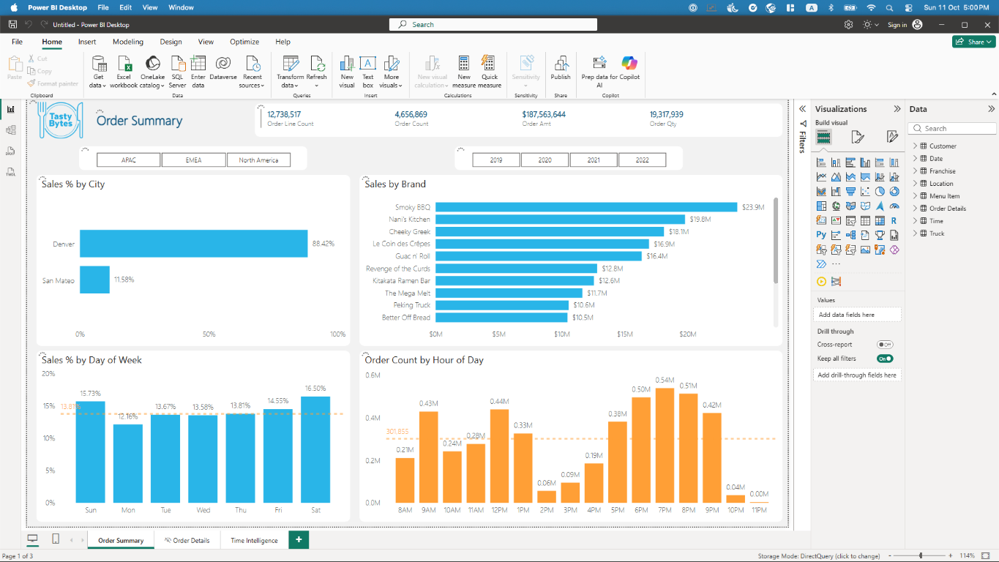

This is the model Autopilot will read. Switch to **Model view** (left rail) to see it: 10 tables, **7 measures**, **18 relationships** and the **5 expressions** that hold the connection parameters. The three time-intelligence measures (`Order Amt YTD`, `Order Amt PYTD`, `YoY Order Amt Growth`) are the ones that will not convert in step 5.

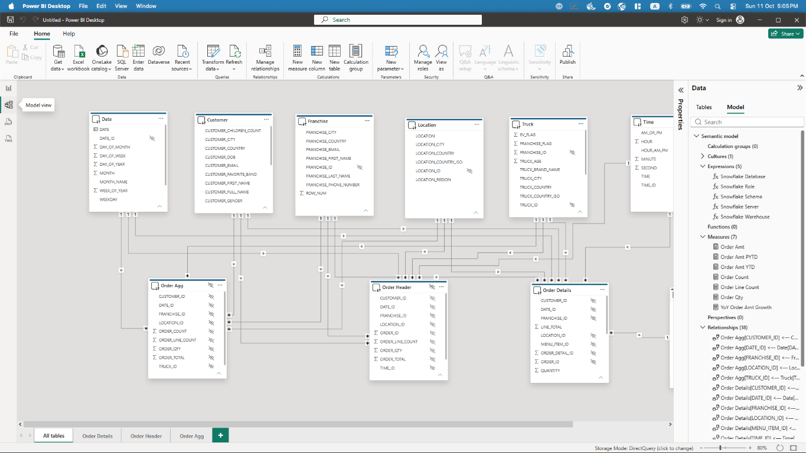

> **Tip —** The APAC and EMEA slicers show no data. The lab loads trucks 1-30, and those trucks only operate in Denver and San Mateo, both in North America. The full data set covers many more cities.

## Step 4 - Import It with Semantic View Autopilot

Now for the payoff: you will let CoCo in Snowsight read the Power BI template and build the semantic view from it.

### Start the Conversation

1. In Snowsight, use role **`TB_PBI_ANALYST`**.
2. Open your git workspace for this repo (it contains `powerbi/TastyBytes_bound.pbit`), then create or open a semantic view file such as `Untitled.sv.yaml`.
3. Open CoCo and enter:

   ```
   Help me create a semantic view
   ```

   If you prefer the menu route, use **Workspaces > + Add new > Semantic view**.

   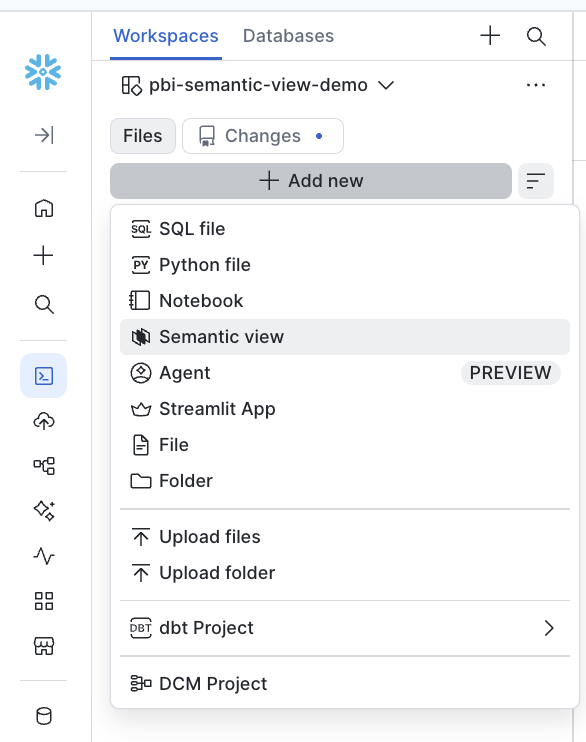

   Snowsight then offers three ways to start. Choose **Create with CoCo (Recommended)**.

   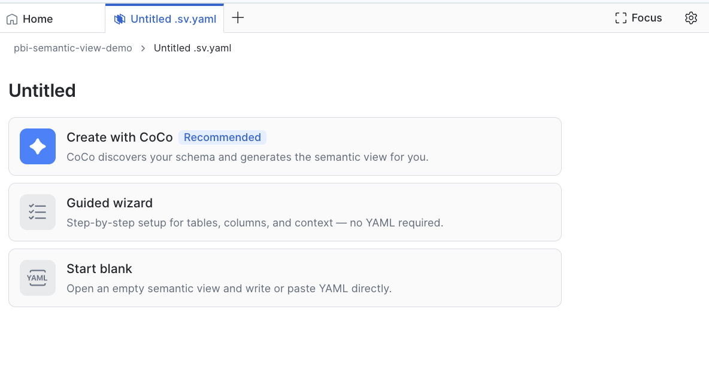

Watch what happens. CoCo finds the template in your workspace and walks you through the rest. You answer a couple of questions along the way (see below).

### How the Conversation Flows

This is captured from the author's run. Your wording and the order of questions will differ, but the counts should match. The whole conversation has three phases: CoCo reads the template, you choose what to import, then you refine the result.

#### Phase 1: CoCo reads the template

1. **CoCo finds the template and stages it.** The import tool reads only from a stage, so CoCo copies `TastyBytes_bound.pbit` into `TB_PBI_DEMO.SEMANTIC.PBI_FILES` (the stage created in `sql/03_roles_and_stage.sql`).

2. **It summarises the Power BI model.**

   | Item | Count |
   |---|---|
   | Tables | 10 |
   | Columns (none calculated) | 108 |
   | DAX measures | 7 |
   | Relationships | 18 |
   | Warnings / unresolved tables | none |

   It also calls the model "large", only because it has more than 100 objects.

3. **It maps each Power BI table to a Snowflake table** (columns / measures):

   | Power BI table | Snowflake table in `TB_PBI_DEMO.POWERBI` | Cols / measures |
   |---|---|---|
   | Customer | `DT_DIM_CUSTOMER` | 17 / 0 |
   | Date | `DIM_DATE` | 11 / 0 |
   | Franchise | `DT_DIM_FRANCHISE` | 8 / 0 |
   | Location | `DT_DIM_LOCATION` | 6 / 0 |
   | Menu Item | `DT_DIM_MENU_ITEM` | 13 / 0 |
   | Time | `DIM_TIME` | 7 / 0 |
   | Truck | `DT_DIM_TRUCK` | 15 / 0 |
   | Order Details | `DT_FACT_ORDER_DETAIL` | 12 / 7 |
   | Order Agg | `DT_FACT_ORDER_AGG` | 9 / 0 |
   | Order Header | `DT_FACT_ORDER_HEADER` | 10 / 0 |

   The mapping works because the Snowflake table names match the Power BI table sources exactly, including the `customer_favorite_band` spelling.

4. **It sorts the 7 measures.**

   | Measure | DAX | Result |
   |---|---|---|
   | Order Count | `DISTINCTCOUNT(ORDER_ID)` | converts |
   | Order Line Count | `COUNTROWS` | converts |
   | Order Amt | `SUM(LINE_TOTAL)` | converts |
   | Order Qty | `SUM(QUANTITY)` | converts |
   | Order Amt YTD | `TOTALYTD` | may not convert |
   | Order Amt PYTD | `SAMEPERIODLASTYEAR` | may not convert |
   | YoY Order Amt Growth | uses `SAMEPERIODLASTYEAR` | may not convert |

#### Phase 2: You choose what to import

5. **It flags the three fact tables and asks how much to import.** The options are:

   1. Everything as-is.
   2. Everything except Order Agg (CoCo's recommendation).
   3. Only Order Details plus the dimensions.

   It also asks whether to write AI descriptions for the metrics.

   **Choose option 3 and say yes to the descriptions.** `Order Agg` and `Order Header` are hidden Power BI **aggregation tables**: every column carries an `alternateOf` pointer back to `Order Details`, so Power BI can answer summary queries from a smaller table. A semantic view has no use for that trick, and importing them would add duplicate paths to the same numbers.

6. **You get a valid semantic view definition.**

   | Item | Value |
   |---|---|
   | Semantic view | `TASTY_BYTES_SV` in `TB_PBI_DEMO.SEMANTIC` |
   | Status | YAML valid, **not deployed** |
   | Saved to | `Untitled.sv.yaml` |
   | Tables | 8 (Order Details + 7 dimensions) |
   | Columns | 89 |
   | Relationships | 7 (Order Details to each dimension) |
   | Metrics | 4: `ORDER_COUNT`, `ORDER_LINE_COUNT`, `ORDER_AMT`, `ORDER_QTY` |
   | AI descriptions | on the metrics only |
   | Dropped | 3 time-intelligence measures (YTD, PYTD, YoY) |

7. **It flags column types worth fixing, and offers next steps:** descriptions for tables and columns, recreating YTD/PYTD/YoY as SQL metrics (this needs your approval), fixing the column types, an audit, and deploying to `TB_PBI_DEMO.SEMANTIC.TASTY_BYTES_SV`.

   - **IDs come through as `FLOAT`.** Power BI types every number as `double`, but Snowflake stores the IDs as `NUMBER(38,0)`. Fix the ID columns and `Truck.FRANCHISE_ID` (Power BI summarises it by count).
   - **`Date.YEAR` is `TEXT`.** It is stored as text in Snowflake, so leave it.
   - **`COGS_USD` and `SALE_PRICE_USD` are labels.** Power BI set them to not summarise, and they are per-unit prices that should not be added up, so leave them.

> **Tip —** Do not worry if your wording differs. If the counts match (10 tables, 108 columns, 7 measures, 18 relationships, then 8 tables, 89 columns, 7 relationships, 4 metrics), you are on track.

#### Phase 3: You refine it

Ask CoCo to do these three things, in this order.

8. **Fix the column types.** Ask CoCo to limit the fix to the IDs and `FRANCHISE_ID`. CoCo has no edit that changes a data type directly, so it removes each column and re-adds a corrected one, then validates the YAML in Snowflake.

   | Change | Columns |
   |---|---|
   | `FLOAT` to `NUMBER` | all 18 `*_ID` columns across the 8 tables, matching how Snowflake stores them |
   | Fact to dimension | `Truck.FRANCHISE_ID`, `Order Details.ORDER_ID`, `Order Details.ORDER_DETAIL_ID`, so they cannot be summed or averaged |
   | Left alone | `Date.YEAR` (stays `TEXT`) and the menu item prices (stay dimensions) |

   `ORDER_COUNT` still works afterwards, because it counts distinct IDs. The YAML stays valid.

9. **Recreate YTD, PYTD and YoY.** `TOTALYTD` adjusts to whatever date the Power BI report is filtered to. A semantic view metric cannot read a report filter, so CoCo has to fix a reference date and asks you to choose:

   | Anchor | Behaviour |
   |---|---|
   | Today (calendar year) | YTD runs from Jan 1 of this year to today. **Returns $0 or NULL here**, because the demo data ends in 2022. |
   | Latest order date in the data | The same metrics, anchored to the most recent order date. **Choose this one.** |

   CoCo checks the data range first: orders run from 2019-01-01 to **2022-11-01**. It then adds three metrics to `Order Details`:

   | Metric | Definition |
   |---|---|
   | `ORDER_AMT_YTD` | Revenue from Jan 1 to Nov 1, 2022 |
   | `ORDER_AMT_PYTD` | Revenue for the same window in 2021 |
   | `YOY_ORDER_AMT_GROWTH` | (YTD - PYTD) / PYTD, NULL when PYTD is 0 |

   To get these to validate, CoCo also makes two supporting changes:

   - **Primary keys.** It confirms every ID is unique on the 7 dimensions and sets each as the primary key. The metrics need one on `Date`, and it makes every join many-to-one.
   - **`ORDER_DATE` fact.** It adds an `ORDER_DATE` fact to `Order Details`, taken from the `Date` table.

   CoCo then checks the logic with a direct SQL query on the source tables, which gives **YTD $82.3M, PYTD $57.4M and YoY growth of +43.5%**. The metrics use the same date windows, so they should return these numbers once the view is deployed. You will run them yourself in step 6.

   > **Tip —** These metrics will not follow a date slicer in Power BI. That is a real difference from the original DAX, so point it out when you demo.

   > **Tip —** The anchor date is **hard-coded** as `2022-11-01`. A semantic view metric cannot contain a subquery, and the analyst role cannot create a helper view, so the date cannot be looked up at query time. If new orders arrive, update the date by hand. The metric descriptions say so.

   > **Not yet observed:** the YTD, PYTD and YoY metrics have not been run through the deployed view. The numbers above come from CoCo's SQL check on the source tables.

10. **Add table and column descriptions.** CoCo drafts a description for the model, all 8 tables and all 92 columns, based on real values in the data (regions, menu categories, the Y/N and 0/1 flags). Each table description states its grain, and the model description gives the data range, 2019-01-01 to 2022-11-01. The YAML stays valid, and it is still **not deployed**.

    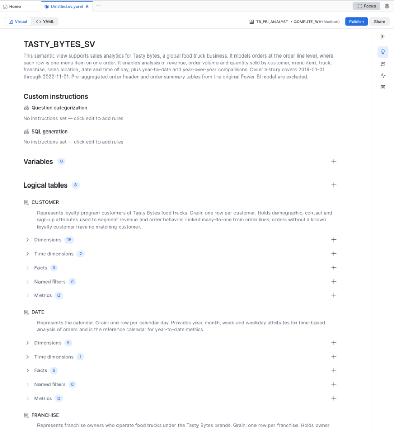

    You can review all of this in the Semantic Studio visual editor: the model description, the 8 logical tables with their dimensions, time dimensions, facts and metrics, and the 7 relationships.

    > **Tip —** A few leftovers from the Power BI import are harmless. For example, `Franchise` keeps a `ROW_NUM` fact typed `FLOAT`, which CoCo describes as a technical row number that is not meaningful for analysis. Remove it if you want a cleaner view.

11. **Deploy and audit.** Tell CoCo to audit and deploy. The quality score is computed from the deployed view, so CoCo deploys first, then audits. The view is created as `TB_PBI_DEMO.SEMANTIC.TASTY_BYTES_SV`, owned by `TB_PBI_ANALYST`.

    CoCo then runs the new metrics against the live view. They match the earlier SQL check exactly:

    | Metric | Result |
    |---|---|
    | `ORDER_AMT_YTD` | $82,335,742 |
    | `ORDER_AMT_PYTD` | $57,371,644 |
    | `YOY_ORDER_AMT_GROWTH` | 0.435 (+43.5%) |
    | `ORDER_COUNT` | 4,656,869 |

    The audit reports the following.

    | Level | Finding |
    |---|---|
    | Score | 57% on the first audit. The main gap was having no verified queries (fixed in the next item). |
    | Warning | The YTD/PYTD anchor date is hard-coded as `2022-11-01`, so the metrics stay stuck there if new orders land. |
    | Warning | `Date.YEAR` is `TEXT`, so a question like "orders in years after 2020" compares text, not numbers. |
    | Warning | `COGS_USD` and `SALE_PRICE_USD` are dimensions, so they cannot be averaged. "Average menu price" may fail or give odd results. |
    | Warning | The model exposes personal data (customer email, phone, date of birth and postal code, plus franchise email and phone) with no masking. |
    | Info | `Franchise.ROW_NUM` is a technical column set as a fact, so it could be summed by mistake. Remove it. |
    | Info | `FRANCHISE_ID` appears on both `Order Details` and `Truck`. That is fine, because only `Order Details` links to `Franchise`. |
    | Info | No duplicate or inconsistent definitions. |

    CoCo's suggested next steps are: add verified queries (the biggest score gain, done in the next item), fix the `YEAR` and price warnings and remove `ROW_NUM`, and hide or remove the personal-data columns.

    > **Tip —** The personal-data warning matters for a partner demo. The lab data is synthetic, but real customer columns should be masked or hidden before a semantic view goes to a wider audience.

    > **Verified independently:** after the deploy, the author's queries on the live view returned $187,563,644 total sales and the same yearly figures as in step 6 (2019: $7,413,440.50, 2020: $25,329,368.00, 2021: $72,485,093.50, 2022: $82,335,742.00). The `SEMANTIC_VIEW()` syntax returned Denver $165,842,404.25 / 4,073,706 orders and San Mateo $21,721,239.75 / 583,163 orders.

    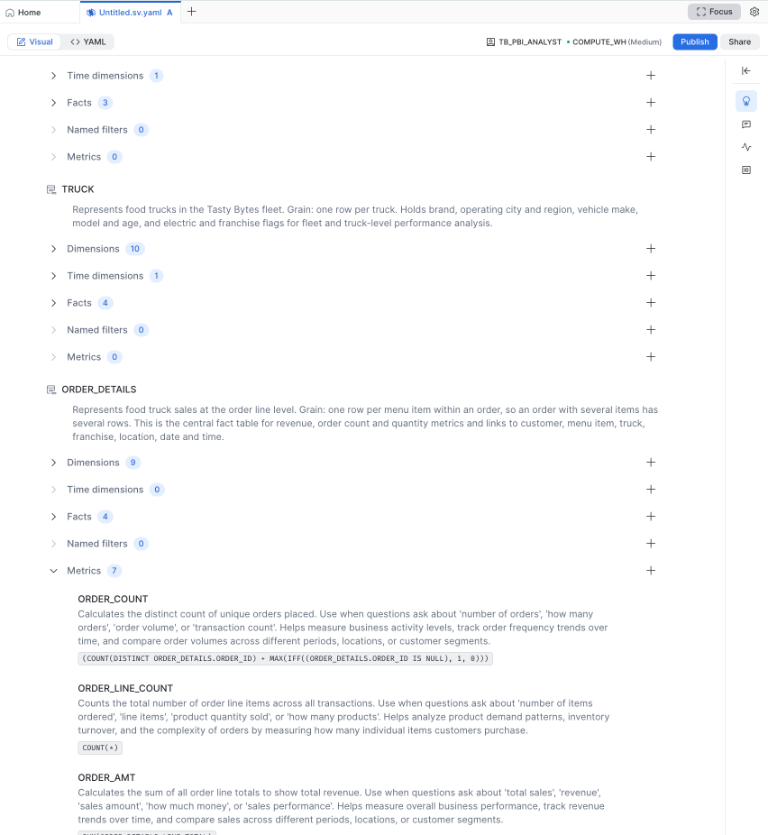

    The three SQL metrics (`ORDER_AMT_YTD`, `ORDER_AMT_PYTD`, `YOY_ORDER_AMT_GROWTH`) sit under `ORDER_DETAILS`, followed by the seven many-to-one relationships. The "Verified queries 0" heading in this shot is the starting point for the next item.

    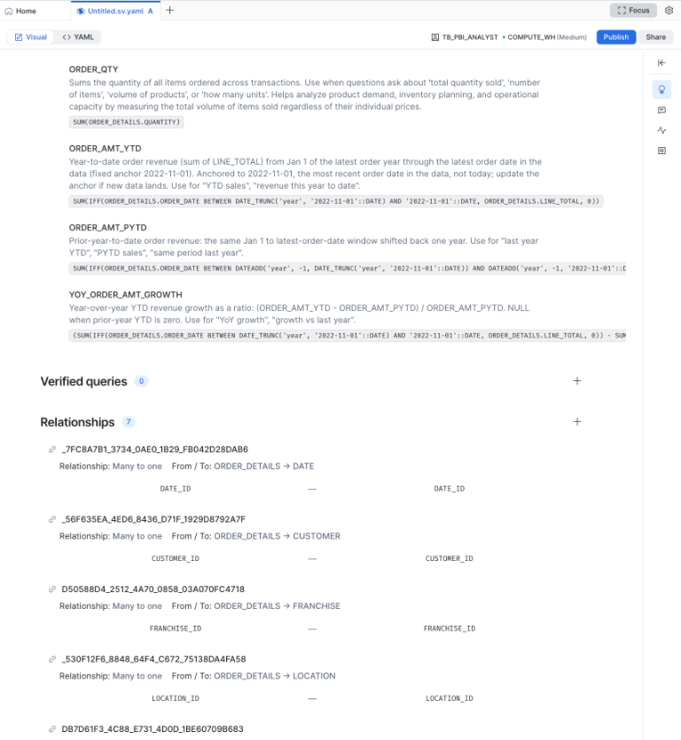

12. **Generate verified queries.** Verified queries are question and SQL pairs that Cortex Analyst treats as known-good answers. They are the biggest single lever on the quality score.

    ```
    Generate verified queries to improve the quality score
    ```

    CoCo pulls suggestions from your query history, validates every candidate against the model, adds them and redeploys. In the author's run it ended with **11 verified queries and the score up from 57% to 83% ("Good")**:

    | # | Question | Source |
    |---|----------|--------|
    | 1 | Total orders, units and revenue year over year | Earlier Cortex Analyst query |
    | 2 | 2022 YTD vs same period 2021 and YoY growth (metrics) | Earlier Cortex Analyst query |
    | 3 | Cities and regions with the most orders | Query history |
    | 4 | 2022 YTD vs 2021, fixed dates (rewritten) | Query history |
    | 5-11 | Revenue by truck brand, top 10 items by quantity, revenue by menu category, revenue by month in 2022, orders by hour, weekend vs weekday, average order value by country | New |

    > **Tip —** Query history yields few suggestions on a fresh account (3 here), so CoCo writes the rest. One history query used dates relative to today, so CoCo rewrote it with fixed dates, otherwise it would drift as the data ages. Queries #2 and #4 overlap; remove one if you want a tidier list.

    > **Tip —** If the redeploy fails, check the metric descriptions: double quotes inside a description break the YAML. CoCo swapped them for single quotes.

    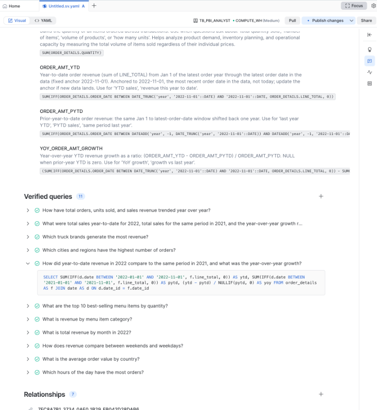

    Still open after this step: the hard-coded `2022-11-01` anchor, personal-data columns, `DATE.YEAR` stored as text, prices modelled as dimensions, and `ROW_NUM`.

### Alternative: the Upload Wizard

If you prefer clicking to chatting, the guided wizard builds a semantic view from the same file with no conversation. It is quick, but it gives you less control.

1. In Snowsight, go to **Workspaces > + Add new > Semantic view** and choose **Guided wizard** (the other options are **Create with CoCo** and **Start blank**).

   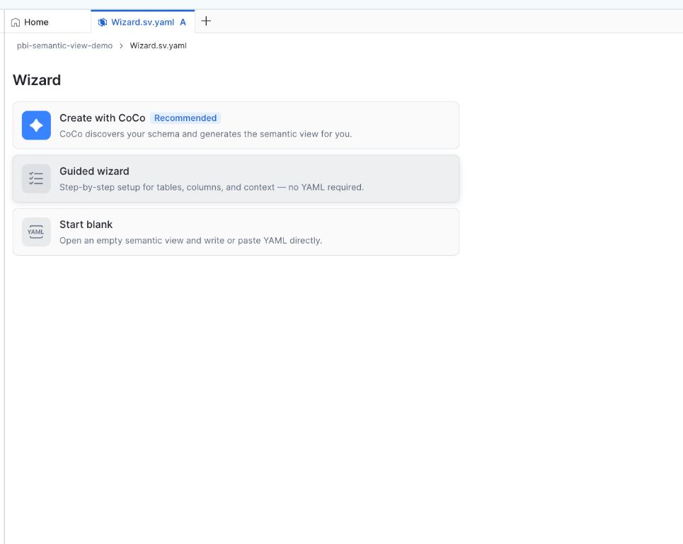

2. On **Provide context**, choose **Power BI** and select **Next**.

   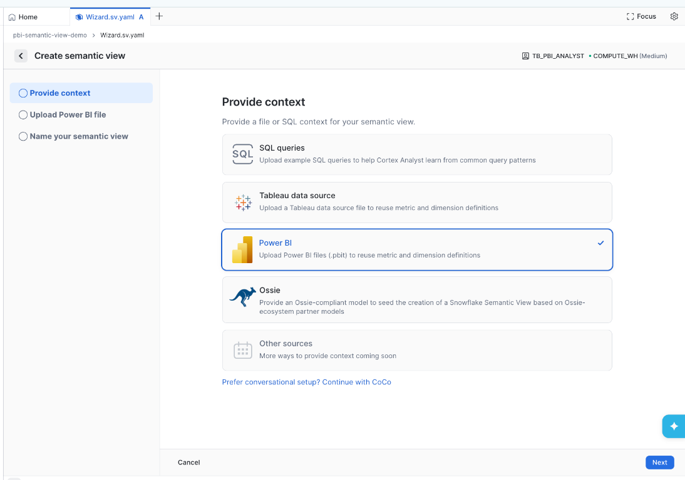

3. On **Upload Power BI file**, select **Browse** and pick `TastyBytes_bound.pbit`. The wizard accepts `.pbix` and `.pbit`.

   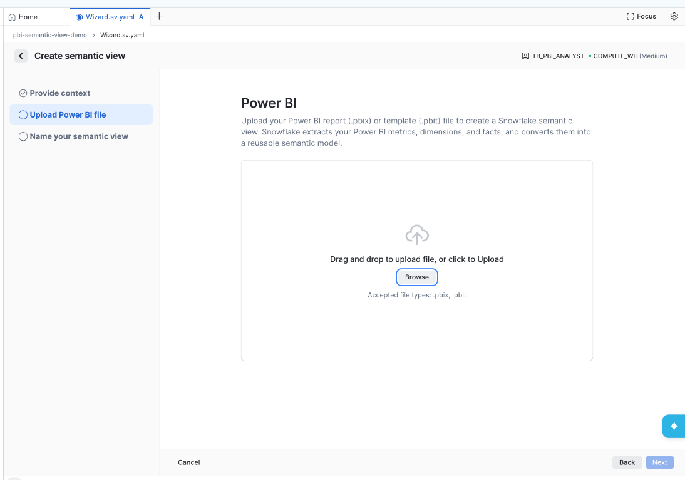

4. Leave **Add sample values** and **Add descriptions** ticked (both are on by default), then select **Next**.

   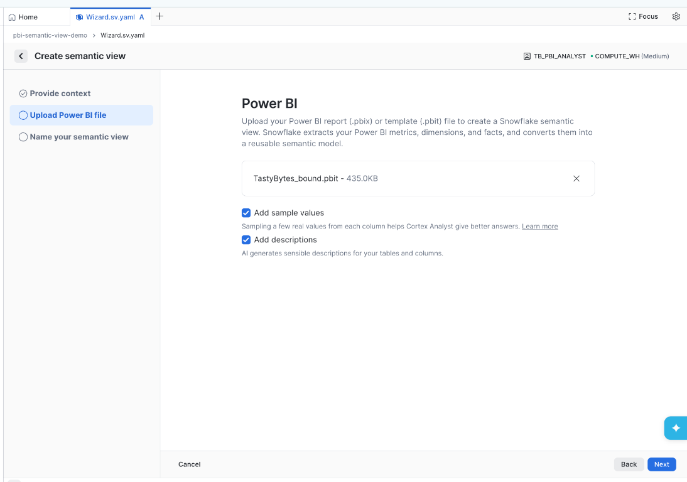

5. Name the view `WIZARD_TASTYBYTES_SV`, keep the target name `default`, store it in `TB_PBI_DEMO.SEMANTIC`, and select **Publish**. A different name keeps it apart from the `TASTY_BYTES_SV` you built with CoCo.

   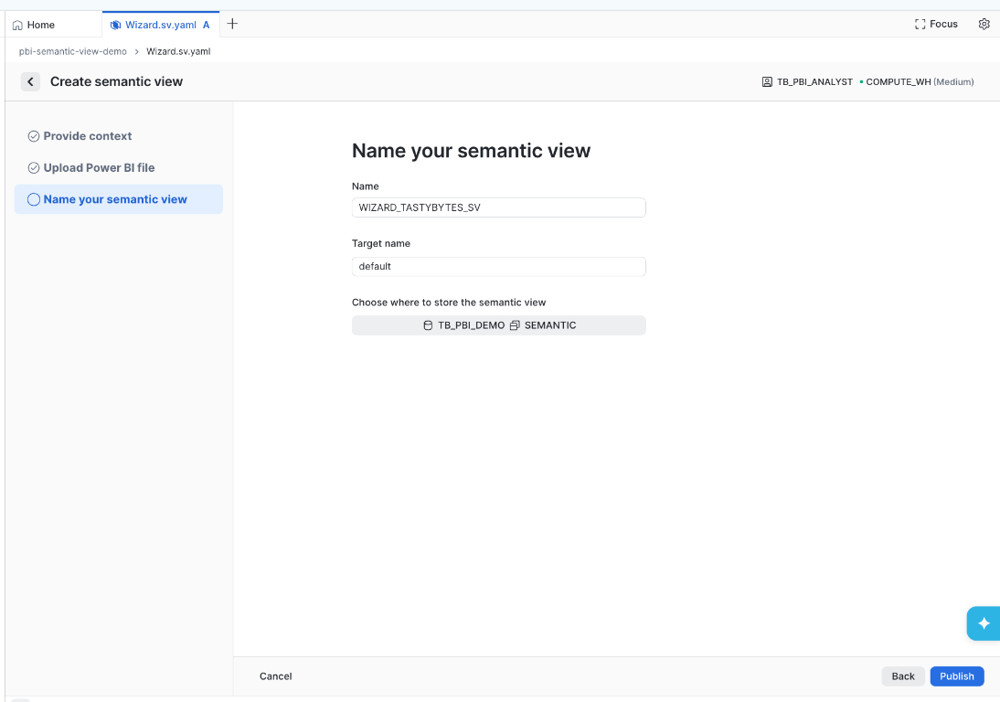

6. Wait while the wizard generates the view (it can take up to 10 minutes). **Show details** lists each stage and any warnings.

   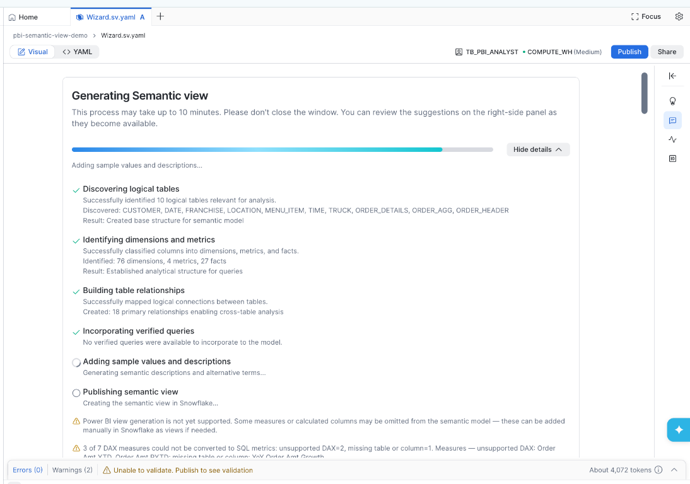

7. When it finishes, the wizard reports **Your semantic view is ready**, with no errors and a suggestions panel on the right.

   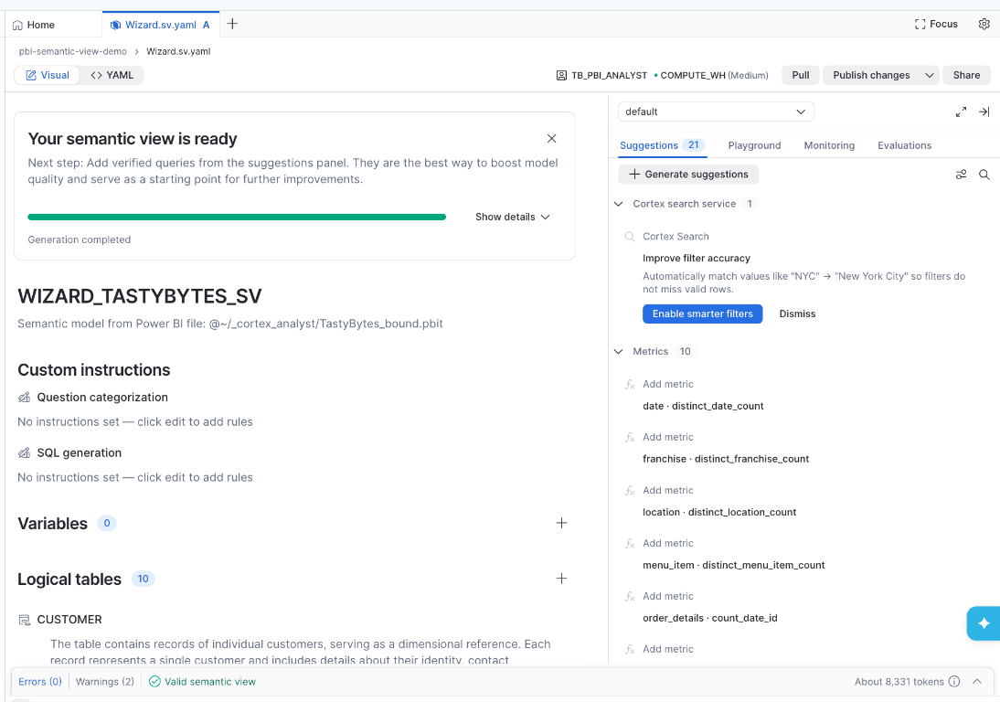

### What the Wizard Produced

| | Upload Wizard | CoCo (Step 4) |
|---|---|---|
| Logical tables | 10, including the Power BI aggregation tables `ORDER_AGG` and `ORDER_HEADER` | 8, with the aggregation tables dropped |
| Dimensions, facts | 76 dimensions, 27 facts | Curated set |
| Relationships | 18 | 7 |
| Metrics | 4, plus 10 suggested | 7, including YTD, PYTD and YoY |
| Verified queries | None | 11 |
| Time-intelligence DAX | Not converted | Converted to SQL metrics |

The wizard raised two warnings:

- Power BI view generation is not yet supported, so some measures or calculated columns may be left out.
- 3 of 7 DAX measures could not be converted: `Order Amt YTD` and `Order Amt PYTD` (unsupported DAX), and `YoY Order Amt Growth` (missing table or column).

Use the wizard for a fast first draft. Use CoCo when you want the time-intelligence measures and verified queries, which is why the rest of this guide continues with `TASTY_BYTES_SV`.

> **Note:** the author ran the wizard on `TastyBytes_bound.pbit` straight from the git workspace, not on a file exported in step 3. Whether the wizard's output depends on the `Server`, `Warehouse` and `Role` values in the file has not been tested. The wizard view was not queried or compared to Snowflake totals.

## Step 5 - Review What Converted

Autopilot lists anything it could not convert, grouped by cause. For this template, expect:

| Power BI measure | DAX | Expected |
|------------------|-----|----------|
| Order Count | `DISTINCTCOUNT(...)` | converts |
| Order Line Count | `COUNTROWS(...)` | converts |
| Order Amt | `SUM(...)` | converts |
| Order Qty | `SUM(...)` | converts |
| Order Amt YTD | `TOTALYTD(...)` | **not converted** (time intelligence) |
| Order Amt PYTD | `SAMEPERIODLASTYEAR` | **not converted** (time intelligence) |
| YoY Order Amt Growth | built on the two above | **not converted** |

That is the point of the exercise: **DAX time intelligence has no direct SQL equivalent**, so migrating a model means deciding what to rebuild by hand. Open **Semantic Studio** and ask CoCo to add a year-to-date metric to the view.

Per the [Power BI ingestion docs](https://docs.snowflake.com/en/user-guide/views-semantic/power-bi-ingestion), these are also unsupported: `SELECTEDVALUE`, `ALLSELECTED`, statistical aggregates (`MEDIAN`, `STDEV`), `RELATEDTABLE`, calculated tables, and measures stored in the report layer instead of the data model.

## Step 6 - Query the Semantic View with SQL

You query metrics with `AGG()` and put dimensions in `GROUP BY`. Use the names Autopilot generated. To list them, run `SHOW SEMANTIC METRICS IN TB_PBI_DEMO.SEMANTIC.TASTY_BYTES_SV;` and `SHOW SEMANTIC DIMENSIONS IN TB_PBI_DEMO.SEMANTIC.TASTY_BYTES_SV;`.

```sql
USE ROLE TB_PBI_ANALYST;
USE SECONDARY ROLES NONE;
USE WAREHOUSE TB_PBI_WH;

SELECT YEAR, AGG(ORDER_AMT) AS order_amt
FROM TB_PBI_DEMO.SEMANTIC.TASTY_BYTES_SV
GROUP BY YEAR
ORDER BY YEAR;
```

Result:

| YEAR | ORDER_AMT |
|------|-----------|
| 2019 | 7413440.5000 |
| 2020 | 25329368.0000 |
| 2021 | 72485093.5000 |
| 2022 | 82335742.0000 |

**Check your answer:** total sales across all years must equal **187,563,644** (the sum of `DT_FACT_ORDER_DETAIL.line_total`). Yearly sales are:

| Year | Sales |
|------|-------|
| 2019 | 7,413,440.50 |
| 2020 | 25,329,368.00 |
| 2021 | 72,485,093.50 |
| 2022 | 82,335,742.00 |

If the semantic view disagrees, a relationship or metric was converted wrongly. Compare against `sql/04_verify.sql`.

## Step 7 - Ask It in Natural Language

Open the semantic view in Snowsight and ask Cortex Analyst, for example:

- *"What were total sales by year?"*
- *"Which truck brand sold the most units in 2022?"*
- *"How many orders did we take per country?"*

The author asked *"What were total sales by year?"* in the Playground tab of Semantic Studio. Cortex Analyst answered from the verified query *"What is total revenue by month in 2022?"* and returned the same four yearly totals as step 6 (2019: 7,413,440.50; 2020: 25,329,368.00; 2021: 72,485,093.50; 2022: 82,335,742.00). The 2022 row ends on 2022-11-01, the last date in the data.

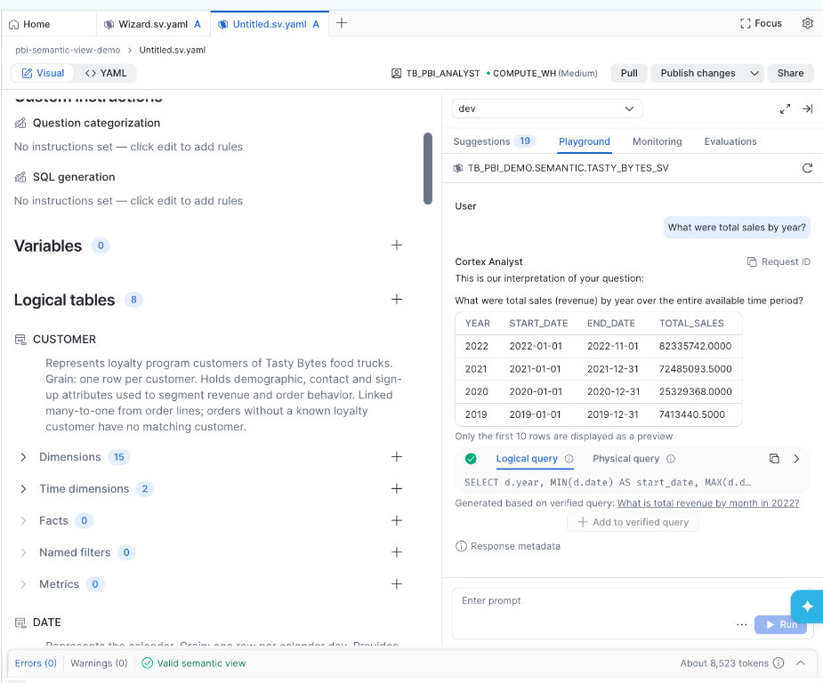

The other two example questions have not been run.

The answers come from the metric definitions you brought across from Power BI, not from ad-hoc SQL.

## Step 8 - Reconnect Power BI to Snowflake (Windows)

Power BI can read the semantic view with a plain SQL statement, so the report uses the metrics you defined in Snowflake instead of its own DAX.

1. In Power BI Desktop, choose **Get data**, select **Snowflake** and choose **Connect**.

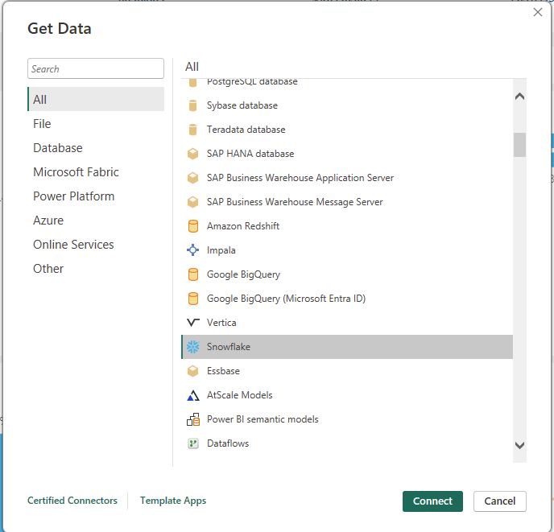

2. Enter your Snowflake server and set the warehouse to `TB_PBI_WH`. Expand **Advanced options** and set:
   - **Role name:** `TB_PBI_ANALYST`
   - **Database:** `TB_PBI_DEMO` (the SQL statement box requires it)
   - **SQL statement:**

```sql
SELECT YEAR, AGG(ORDER_AMT) AS order_amt, AGG(ORDER_COUNT) AS order_count
FROM TB_PBI_DEMO.SEMANTIC.TASTY_BYTES_SV
GROUP BY YEAR
ORDER BY YEAR
```

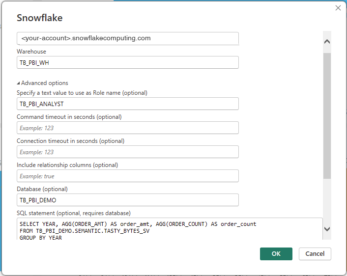

3. Choose **OK** and sign in. The preview returns one row per year:

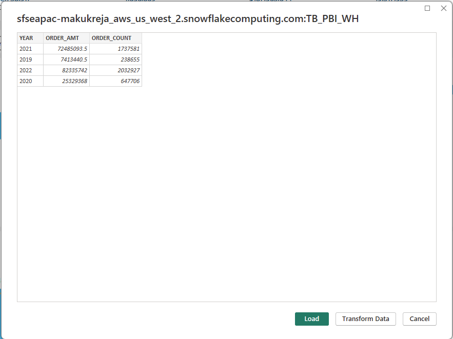

The numbers match the totals you verified in step 6: 2019 is 7,413,440.50, 2020 is 25,329,368.00, 2021 is 72,485,093.50 and 2022 is 82,335,742.00. The order counts add up to 4,656,869.

The point to land: the report now reads governed metrics that are defined once, in Snowflake.

### Extended Test (Not Yet Run)

Rebuild the visuals of the original Order Summary report on top of the semantic view, so every measure comes from `AGG()` instead of DAX.

## Step 9 - Clean Up

Run `sql/99_teardown.sql`. It drops `TB_PBI_DEMO`, `TB_PBI_WH` and `TB_PBI_ANALYST`, including any semantic views you created inside the database.

---

## Troubleshooting

| Symptom | Fix |
|---------|-----|
| Autopilot says `UNBOUND_PARAMETERS` or finds no tables | The template you used still has empty or wrong parameters. Redo step 3 and use the **exported** file |
| Autopilot cannot see tables | You are not on `TB_PBI_ANALYST`, or `03_roles_and_stage.sql` did not finish |
| A verify check shows `FAIL` | Re-run the file named in the message |
| `Schema ... does not exist or not authorized` in step 6 | Expected for `RAW_POS`. For `POWERBI` or `SEMANTIC`, re-run step 1 part 3 |
| Role test passes when it should fail | Run `USE SECONDARY ROLES NONE` first |
| Power BI cannot connect | Check the server host (hyphens, not underscores) and that you sign in as a user holding `TB_PBI_ANALYST` |

## Test Status of This Guide

| Step | Status |
|------|--------|
| 1 Data foundation | Tested: counts match the source data exactly |
| 2 Verify | Tested: 7/7 PASS, role boundary confirmed |
| 3 Point template at your account | Tested by the author: the template opens in Power BI Desktop, connects (key-pair auth) and totals match Snowflake exactly. **Not yet tested:** that File > Export keeps the parameter values for Autopilot |
| 4 Autopilot import | Tested by the author via CoCo: import, refine, deploy and audit done; all totals verified on the deployed view. Wizard route run and documented, but its view was not queried |
| 5 Conversion review | **Expectations from the docs, not yet observed** |
| 6 Query | Tested by the author: yearly `AGG(ORDER_AMT)` query matches Snowflake |
| 7 Natural language | One question tested in the Playground (sales by year, totals match). **Not yet run:** the other two examples |
| 8 Power BI reconnect | Tested by the author on Windows: the `AGG()` query loads and the yearly totals match Snowflake. **Not yet run:** rebuilding the original report's visuals |
