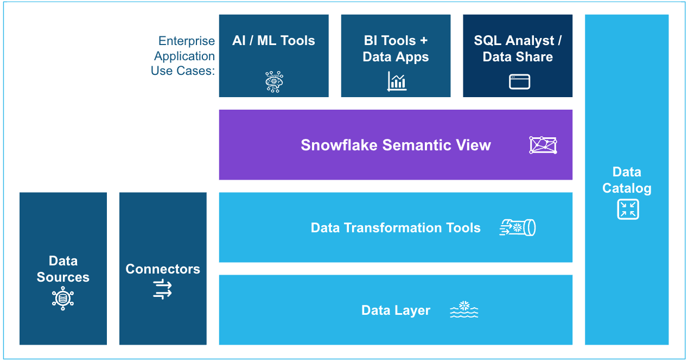

# From Power BI to a Snowflake Semantic View

**Hands-on lab · NZ SI Partner HOL · Demo 4**

## Why Are We Here?

This lab shows how to bring the business logic you already built in Power BI into Snowflake as a **semantic view**. You will use Semantic View Autopilot, which reads a Power BI template and generates the semantic view for you, and then query it with SQL, ask it questions in natural language and reconnect Power BI to it.

You will do the work with [CoCo](https://docs.snowflake.com/en/user-guide/cortex-code/cortex-code), the AI agent built into Snowsight, so most steps are a conversation, not hand-written YAML.

## What Is a Semantic View?

A semantic view is a schema-level object that stores business meaning next to the data. It lets you define business metrics and model business entities and their relationships once, so every tool uses the same definitions. See [Overview of semantic views](https://docs.snowflake.com/en/user-guide/views-semantic/overview).

*Source: Snowflake documentation. The semantic view sits between your data and every tool that consumes it.*

Inside a semantic view you define logical tables that map to business entities such as customers, orders or franchises. On them you define three kinds of element:

| Element | What it is | Example in this lab |
|---|---|---|
| **Dimension** | A categorical attribute: who, what, where, when | `CITY`, `MENU_ITEM`, `YEAR` |
| **Fact** | A row-level value that metrics are built from | order line amount |
| **Metric** | A business measure calculated by aggregating facts | `ORDER_AMT`, `ORDER_COUNT`, year-to-date amount |

Without a semantic view, the same idea such as "net revenue" ends up written many times in different reports, sometimes with the wrong aggregation. With one, there is a single authoritative definition that BI tools, Cortex Analyst, agents and plain SQL all share.

## Where Should the Logic Live?

Snowflake's guidance is to keep Power BI as the experience your users know and to put the shared, governed business logic in the Snowflake semantic view:

| Logic | Where |
|---|---|
| Enterprise KPIs, joins, dimensions, business definitions, and anything an AI agent should also use | Snowflake semantic view |
| Report layout, visuals, slicers and one-off report calculations | Power BI |

Semantic View Autopilot is the way to get from the first to the second without starting from a blank page. It generates a first draft that you then review, because report-level measures and time-intelligence functions such as `TOTALYTD` and `SAMEPERIODLASTYEAR` are not yet fully supported. Steps 4 and 5 show exactly what that looks like. See [Power BI ingestion feature support](https://docs.snowflake.com/en/user-guide/views-semantic/power-bi-ingestion) and the [general availability release note](https://docs.snowflake.com/en/release-notes/2026/other/2026-08-18-semantic-views-power-bi-ingestion-ga).

!!! tip "Ready to start?"
    Go to **Setup** in the left navigation, then work through the steps in order. Each step builds on the one before.

## The Lab
